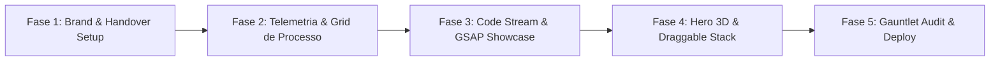

# Roadmap de Melhorias: Craft, Animações & Identidade de Marca

> **Status**: Aprovado para Implementação via Multi-Agentes  
> **Referência Conceitual**: Portfólio Aonnoy Sengupta (`aonnoysengupta.com`) adaptado para Engenharia de Sistemas  
> **Pilar Central**: *Craft Visual AAA com Arquitetura Static-First, Zero FOUC e WCAG 2.2 AAA Preservados*

---

## 1. Visão Estratégica & Diagnóstico

O portfólio de **João Natividade** (`joaosnet.github.io`) já possui uma das bases técnicas mais sólidas da web moderna:
- Arquitetura **Static-First** gerada deterministicamente via Python 3.14 (`build_site.py`) e Jinja2.
- Tempo de renderização inicial sub-50ms e conformidade estrita com **WCAG 2.2 AAA** (taxas de contraste > 7:1).
- Prerender multilíngue nativo (`/`, `/en/`, `/es/`) e PDFs técnicos compilados via ReportLab.

O objetivo deste roadmap é incorporar o **refinamento estético, dinamismo e micro-interações táteis** observados no trabalho de Aonnoy Sengupta, sem comprometer a integridade e a velocidade da arquitetura atual. 

A abordagem adotada é o **Progressive Enhancement Híbrido**: o HTML/CSS semântico é entregue instantaneamente, enquanto as camadas visuais ricas (Three.js/Canvas, GSAP ScrollTrigger e Lenis) são carregadas de maneira assíncrona, sob demanda, respeitando estritamente dispositivos móveis e usuários com sensibilidade a movimento.

---

## 2. Identidade de Marca & Direcionamento Visual

### 2.1 Conceito: "Engenharia de Sistemas & Craft Computacional Rigoroso"
Enquanto o site de referência utiliza analogias da mitologia grega (`fig. 01 · hephaestus`), a identidade deste portfólio será ancorada em **sistemas de computação, hardware, arquitetura de processadores e telecomunicações**:

- **Nomenclatura Técnica**:
  - Em vez de figuras genéricas, as seções e pilares técnicos adotam anotações de engenharia:
    - `fig. 01 · kernel`: Sistemas operacionais, drivers e firmware bare-metal.
    - `fig. 02 · bus`: Barramentos de dados, redes e telemetria distribuída.
    - `fig. 03 · silicon`: Arquitetura de computadores, VHDL/Verilog e IoT.
    - `fig. 04 · compiler`: Pipelines determinísticos, ASTs e compiladores estáticos.
- **Estética Editorial & Tipografia Suíça**:
  - Contraste refinado entre uma fonte grotesca geométrica de alta legibilidade para títulos e textos corridos (ex: Inter / Geist Sans) e uma fonte monoespaçada de precisão mecânica para metadados, métricas e tags técnicas (ex: JetBrains Mono / Geist Mono).
  - Escala tipográfica rigorosa baseada em razão modular (1.25 / Major Third) com entrelinhamento ótico inverso.
- **Ritmo Espacial e Acabamento**:
  - Cadência estrita em grade de 4px / 8px.
  - Divisores e bordas com precisão submétrica (`1px solid var(--border-subtle)` com gradientes sutis em ângulos retos).

---

## 3. Arquitetura Técnica de Animação

```text
┌────────────────────────────────────────────────────────────────────────┐
│                   PROGRESSIVE ENHANCEMENT PIPELINE                     │
│                                                                        │
│   [Etapa 0: HTML/CSS Base]                                             │
│     Static Prerender (Jinja2) ──► Render Instantâneo (< 50ms)          │
│                                   Layout Linear 100% Funcional e AAA   │
│                                                                        │
│   [Etapa 1: Feature Detection & Preferências]                          │
│     prefers-reduced-motion?     ──► SIM: Encerra aqui (Modo Estático)  │
│     GPU/Rede Lenta?             ──► NÃO: Carrega orquestrador dinâmico │
│                                                                        │
│   [Etapa 2: Hydration Dinâmica de Micro-Interações]                    │
│     assets/js/animations/       ──► Lenis (Smooth Scroll Modular)      │
│                                 ──► GSAP ScrollTrigger (Pinning)       │
│                                 ──► Canvas 3D (Three.js sob demanda)   │
└────────────────────────────────────────────────────────────────────────┘
```

### 3.1 Camadas de Script e Isolamento
1. **`assets/js/boot.js` (Crítico - Inline / Bloqueante síncrono)**:
   - Resolve tema escuro/claro e preferência de movimento (`prefers-reduced-motion`) antes da primeira pintura, garantindo **Zero FOUC**.
2. **`assets/js/animations/orchestrator.js` (Assíncrono / Deferred)**:
   - Gerencia a ativação condicional de GSAP e Lenis. Se o usuário estiver em dispositivo de baixa potência ou com redução de movimento, estes módulos nem chegam a ser requisitados.
3. **`assets/js/3d/hero-canvas.js` (Lazy-loaded via IntersectionObserver)**:
   - Instancia o contexto WebGL apenas quando a seção Hero estiver visível na janela de exibição. Pausa o loop `requestAnimationFrame` sempre que a aba perder foco ou o elemento sair do viewport.

---

## 4. As 5 Experiências Interativas Prioritárias

### 4.1 Showcase de Projetos em Abas Fixadas (Pinned Code Stream)
- **Inspiração**: Seção *Selected Work* do Aonnoy com arquivos horizontais/verticais (`hunterbrook-migration.md`, `CleanSpaceportal.tsx`).
- **Implementação**:
  - O container da seção é fixado (*pinned*) via GSAP `ScrollTrigger`.
  - À medida que o usuário rola a página, a rolagem vertical se converte em transição de abas de arquivos técnicos (`kernel-driver.c`, `sensor-mesh.ino`, `static-compiler.py`).
  - Cada slide exibe:
    - Cabeçalho de arquivo com numeração de linha e metadados (`// result: 99.98% uptime, zero memory leaks`).
    - Diagrama esquemático em SVG com linhas que se desenham (*path stroke animation* sincronizada com o scroll).
    - Métricas quantificáveis de engenharia e link direto para o case study.
- **Fallback Acessível**: Se `prefers-reduced-motion: reduce`, o container não trava o scroll e os projetos são apresentados em cards verticais sequenciais e limpos.

### 4.2 Hero Interativo 3D / Canvas Leve (Topology Mesh)
- **Conceito**: Uma malha interativa tridimensional representando nós de barramento e traços de placa de circuito impresso (PCB/Silicon traces).
- **Interação**:
  - Responde suavemente à posição do cursor (com interpolação linear/lerp) e ao acelerômetro em dispositivos móveis.
  - Ao passar o mouse sobre os nós, pulsos luminosos de dados trafegam pelas conexões.
- **Restrição de Performance**:
  - WebGL puro ou Three.js minificado (< 40KB gzipped).
  - Target: 60/120 FPS fixo em GPU integrada, com consumo < 2% de CPU.
  - Fallback: Vetor SVG geométrico de altíssima definição estático.

### 4.3 Cartões Interativos com Física de Mola (Draggable Stack)
- **Inspiração**: Pilha de cartões em *Testimonials* ("drag the top note away").
- **Aplicação no Portfólio**:
  - Utilizado para exibir **Recomendações Técnicas, Certificações de Engenharia e Benchmarks de Sistema**.
  - O usuário pode arrastar o cartão do topo com mouse ou toque na tela.
  - Utiliza equações de mola com inércia física (gestures com rotação angular proporcional à velocidade do arraste).
  - Ao soltar fora do limiar (*threshold*), o cartão voa para fora e o próximo assume o foco; botões acessíveis "Anterior" e "Próximo" oferecem controle 100% via teclado para navegação WCAG.

### 4.4 Grid de Metodologia & Ciclos de Engenharia (Interactive Sprints)
- **Inspiração**: Grade *Built in sprints. Live in weeks.* do Aonnoy.
- **Adaptação para Engenharia de Sistemas**:
  - Grade matricial dividida em ciclos e semanas (`Cycle 01: Especificação Formal & Modelagem`, `Cycle 02: Arquitetura de Baixo Nível`, `Cycle 03: Prototipagem Bare-Metal`, `Cycle 04: Auditoria Gauntlet & Verificação Formal`).
  - O usuário pode passar o cursor ou clicar em cada bloco de dia/etapa para abrir detalhes de entregáveis, critérios de teste e garantias de isolamento.
  - Animação sutil de preenchimento progressivo ao rolar até a seção.

### 4.5 Barra de Status & Telemetria em Tempo Real
- **Inspiração**: Cabeçalho com localização e fuso horário (`portsmouth, uk // --:-- GMT`).
- **Implementação Técnica**:
  - Header compacto e estilizado como terminal de bordo:
    ```text
    belém, pa // [21:55:10 BRT] // status: open for systems engineering & research // telemetry: 0ms static
    ```
  - Relógio de precisão local atualizado via timer nativo leve (`requestAnimationFrame` sincronizado ao segundo).
  - Indicador pulsar sutil verde em CSS puro para status ativo.

---

## 5. Matriz de Governança Multi-Agente & Handover Framework

Para evitar que diferentes sessões e agentes de IA sobreponham trabalho ou gerem inconsistências na base de código, adota-se o modelo de **4 Especialistas Autônomos com Handover Files**:

```text
.
├── specs/
│   └── brand/
│       ├── tokens.json
│       ├── typography.md
│       └── HANDOVER.md         <── [Agente 1: Brand & Design]
│
├── assets/
│   ├── js/
│   │   ├── 3d/
│   │   │   ├── hero-mesh.js
│   │   │   └── HANDOVER.md     <── [Agente 2: 3D & Shaders]
│   │   └── animations/
│   │       ├── scroll-stream.js
│   │       ├── draggable-cards.js
│   │       └── HANDOVER.md     <── [Agente 3: Code & Animation]
│
├── content/
│   ├── site.json
│   ├── projects.json
│   ├── ui.json
│   └── HANDOVER.md             <── [Agente 4: Copy & Tech Docs]
│
└── docs/
    └── next-improvements-roadmap.md (Este arquivo - Fonte Canônica)
```

### 5.1 Especificação dos Papéis e Pastas

| Especialista | Escopo de Atuação | Diretório Exclusivo | Arquivo de Handover |
| :--- | :--- | :--- | :--- |
| **Agent 1: Brand & Design** | Paleta de cores, tipografia, tokens de espaçamento, diretrizes visuais e SVG assets. | `specs/brand/`, `assets/img/` | `specs/brand/HANDOVER.md` |
| **Agent 2: 3D & Shaders** | Modelagem da malha de barramento, shaders WebGL/Three.js, performance de render e fallback SVG. | `assets/js/3d/` | `assets/js/3d/HANDOVER.md` |
| **Agent 3: Code & Animation** | Implementação de Lenis, timelines GSAP, física de arrasto, micro-interações e CSS. | `assets/js/animations/`, `assets/css/` | `assets/js/animations/HANDOVER.md` |
| **Agent 4: Copy & Tech Docs** | Redação técnica sem clichês, estudos de caso, metadados multilíngues e relatórios. | `content/`, `docs/` | `content/HANDOVER.md` |

### 5.2 Estrutura Padronizada de cada `HANDOVER.md`
Cada agente deve manter seu respectivo arquivo com o seguinte formato:
```markdown
# Handover: [Nome da Área]
- **Última Atualização**: YYYY-MM-DD por [Agente/Sessão]
- **Status Atual**: [Resumo em 3 linhas do que está implementado]
- **Arquivos sob Propriedade Rígida**:
  - `caminho/do/arquivo.ext`
- **Decisões Técnicas Consolidadas**:
  - [Decisão 1 e justificativa]
- **Próximas Tarefas Imediatas**:
  - [ ] Tarefa pendente 1
- **Bloqueios ou Dependências de Outros Agentes**:
  - [Dependência do Agente X]
```

### 5.3 Regra de Ouro da Orquestração (Tech Lead)
- **Nenhum agente edita arquivos fora de seu diretório exclusivo**. Se o Agente de Animação precisar de uma chave nova em `content/site.json`, ele deve registrar a solicitação no handover e solicitar ao Agente de Copy.
- **João Natividade atua como Tech Lead**: Revisão de cada commit, validação do build estático e aprovação para produção.

---

## 6. Acessibilidade Inegociável (WCAG 2.2 AAA) & "The Bar"

Para que qualquer nova funcionalidade seja considerada pronta pelo ciclo **Gauntlet Loop (Builder vs. Critic)**, os seguintes critérios inegociáveis devem ser atestados:

1. **Prevalência Absoluta de `prefers-reduced-motion`**:
   - Lenis é 100% desativado; o scroll permanece nativo do sistema operacional.
   - GSAP ScrollTrigger desliga pinning (travamento de tela) e transições laterais.
   - O loop do Canvas 3D é completamente congelado, sendo substituído por um poster vetorial estático.
2. **Contraste e Legibilidade**:
   - Todos os textos sobre animações ou canvas mantêm contraste mínimo de 7:1 contra o fundo em dark e light mode.
   - Todos os elementos interativos possuem anel de foco visível com pelo menos 2px e contraste 3:1.
3. **Navegabilidade por Teclado e Leitores de Tela**:
   - Todos os cartões arrastáveis e abas de projetos podem ser operados via teclas `Tab`, `Setas` e `Enter`.
   - Textos dentro de canvas ou shaders possuem equivalentes semânticos em HTML ocultos para leitores de tela (`aria-live` / `.sr-only`).
4. **Desempenho no Lighthouse**:
   - Performance: 100
   - Accessibility: 100
   - Best Practices: 100
   - SEO: 100

---

## 7. Fases de Execução do Roadmap



- **Fase 1: Fundação de Marca & Governança Multi-Agente**
  - Criação da pasta `specs/brand/` e dos arquivos iniciais de `HANDOVER.md`.
  - Refinamento de tokens tipográficos e paleta técnica de sistemas.
- **Fase 2: Barra de Telemetria & Grid de Engenharia**
  - Adição da barra de status com relógio local e latência no header.
  - Implementação do grid de sprints de engenharia em CSS Grid com micro-interações.
- **Fase 3: Showcase Paginado de Projetos com GSAP**
  - Integração modular do GSAP ScrollTrigger via dynamic import.
  - Implementação do scroll que percorre arquivos técnicos (`fig. 01 · kernel`, etc.).
- **Fase 4: Hero 3D & Cartões Draggable**
  - Desenvolvimento da malha 3D de circuitos (Three.js leve / WebGL) com lazy loading.
  - Implementação da física de arrasto com fallback de botões acessíveis.
- **Fase 5: Auditoria Gauntlet Loop & Lançamento**
  - Testes end-to-end com Playwright (`@playwright/test` e `@axe-core/playwright`).
  - Auditoria de taxas de quadros (60 FPS contínuos) e validação de acessibilidade WCAG 2.2 AAA.
  - Build final via `build_site.py` e deploy no GitHub Pages.
